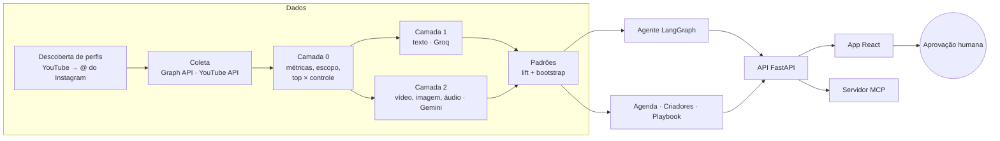
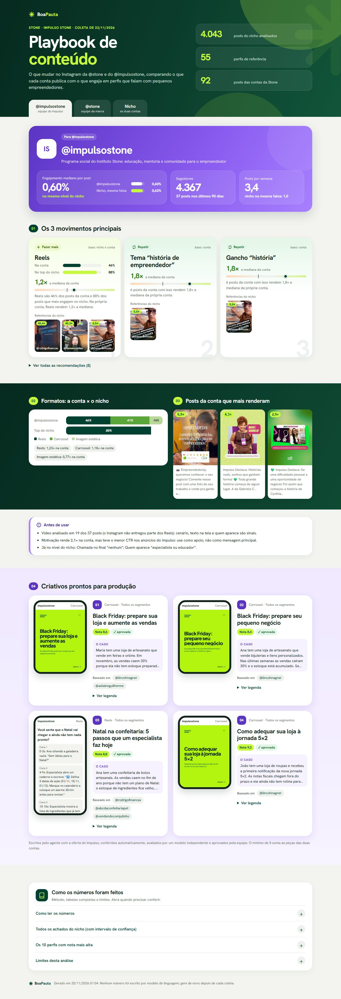
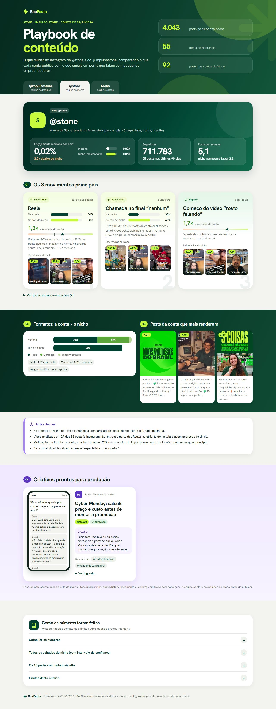
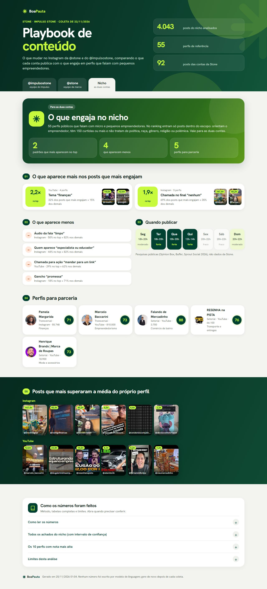

# BoaPauta

*O que engaja o empreendedor vira post do Impulso Stone.*

Projeto individual Stone × Inteli Academy, entregue em 24/11/2026.

- **App no ar:** [case-stone.onrender.com](https://case-stone.onrender.com)
- **Arquitetura e decisões em detalhe:** [docs/arquitetura.html](docs/arquitetura.html)

## Contexto

O Impulso Stone é o programa de educação, mentoria e comunidade da Stone para micro e pequenos empreendedores (MPEs). Para produzir conteúdo que de fato prenda esse público, a equipe precisa responder a uma pergunta que nenhuma ferramenta de redes sociais responde sozinha: **por que** alguns posts engajam muito mais do que outros? Saber quais posts foram bem é fácil. Separar o que é típico do sucesso do que é apenas comum no nicho dá mais trabalho.

O BoaPauta parte dessa pergunta. Ele acompanha 55 criadores que falam com o empreendedor brasileiro no Instagram e no YouTube, coleta os posts públicos pelas APIs oficiais, compara os que mais engajaram com um grupo controle sorteado e transforma as diferenças estatisticamente consistentes em achados. Esses achados alimentam um agente que propõe e escreve peças para o **@impulsostone** e para a **@stone**, sempre citando os posts reais em que se apoia. Em volta do agente há uma agenda editorial, a indicação de criadores para parceria, o *Playbook de conteúdo* para a Stone e um e-mail semanal ao empreendedor. Nada é publicado sem aprovação humana.

O projeto respeita a restrição do case: não há scraping nem nenhuma rota que viole os Termos de Uso das plataformas. Por isso o Instagram é lido pela Graph API (Business Discovery) e o YouTube pela Data API v3.

## Arquitetura

O sistema tem quatro blocos: o **pipeline de dados**, que transforma posts públicos em achados; o **agente**, que transforma achados em peças; a **camada de serviço** (API, app e servidor MCP), por onde a equipe trabalha; e os **produtos derivados** (agenda, criadores, playbook e guia semanal).



### Pipeline de dados

A base começa pela **descoberta de perfis**. A Graph API remove as menções (@) das legendas de terceiros, então a busca é feita no YouTube, cujas descrições costumam trazer o @ do Instagram do criador. Os candidatos passam por filtros de atividade e tamanho e por uma revisão humana: 56 perfis foram aprovados e as recusas ficam registradas com o motivo.

A **coleta** traz cerca de seis meses de posts de cada perfil, com um limitador que respeita o teto de chamadas da Meta e retoma de onde parou. A rodada de 22/11/2026 reuniu 4.043 posts de 55 perfis. Os dados brutos ficam em JSONL, versionados pela data da coleta.

A **camada 0** é puramente determinística (pandas, sem modelo de linguagem). Ela calcula as métricas de cada post, decide quais são elegíveis, aplica o filtro de escopo e separa o top e o grupo controle (detalhes na seção de análises). Nenhum post é apagado: quem fica de fora recebe a marcação e o motivo.

A **camada 1** usa um modelo de linguagem no Groq para rotular o texto de cada post do top e do controle: tema, tipo de gancho, chamada para ação, tom, convite a participar, presença de frase motivacional genérica e se é publicidade. A **camada 2** usa o Gemini para ler vídeo, imagem e áudio: quem aparece, se há rosto e fala nos três primeiros segundos, texto na tela, cenário, nível de produção, chamada final, música de fundo e volume, tom e ritmo da fala e qualidade do áudio. Todo vídeo segue o mesmo protocolo, seja Short, Reels ou vídeo longo: capa, os cinco primeiros segundos, cinco segundos do meio e os cinco finais (vídeos com menos de 15 s vão inteiros). Isso deixa a comparação justa entre formatos e reduz de três a cinco vezes o custo por post. Como o plano gratuito limita pedidos por dia, e não tokens, vários posts vão no mesmo pedido, cada um identificado.

Por fim, o módulo de **padrões** compara cada característica rotulada entre o top e o controle e decide o que vira achado, o que é inconclusivo e o que está concentrado em poucos perfis.

### Agente

O agente é um grafo em **LangGraph** com uma regra de economia: a proposta (formato, padrões que sustentam a ideia e posts reais de base) sai apenas da base de dados, sem modelo de linguagem. O modelo só roda quando a equipe dá o "ok", então nenhum token é gasto em ideia descartada.

Na geração, o modelo (`gpt-oss-120b`, no Groq) parte de um **caso concreto**, ou seja, um pequeno negócio, a dor específica e o que acontece se nada mudar, e lê o conteúdo completo dos posts de referência, incluindo o que se vê e as primeiras falas extraídas pela camada 2. Cada conta tem a sua oferta: o Impulso fala de educação, mentoria e comunidade; a Stone fala de maquininha, conta, link de pagamento e crédito, sem citar taxas nem condições.

O rascunho passa por oito **conferências determinísticas** no código: referências reais, caso concreto, chamada clara, ausência de promessa, fidelidade à oferta da conta, ausência de contas e fórmulas, clareza (Flesch adaptado ao português) e tamanho. Se alguma falha, o agente reescreve até duas vezes. Depois, um **juiz** de outra família de modelo (`qwen3.8-27b`) avalia a peça numa rubrica de sete critérios, entre eles a *profundidade*: um conselho óbvio sem o "como fazer" recebe no máximo 4. Se o juiz reprova ou dá menos de 7 em algum critério, o agente reescreve uma vez com o retorno dele (critério, nota, justificativa e trecho). A nova versão só é aceita se subir a média sem criar um critério fraco novo. Cada execução, com o antes e o depois, fica registrada para auditoria.

### Serviço e interface

A **API FastAPI** é a única porta de entrada para a base e para o agente. Ela transmite cada etapa da geração ao vivo (*server-sent events*), guarda o estado das peças, versões, decisões e guias em **SQLite** e protege com senha opcional as ações que gastam cota ou alteram dados.

O **app em React** é organizado pelo trabalho da equipe. O *Planejamento* traz o calendário com as sugestões da agenda e um painel lateral em que a conversa guiada leva da sugestão à proposta, da proposta à geração ao vivo e daí à peça pronta, que pode ser aprovada ou ajustada em linguagem livre. As *Peças* formam a fila de revisão. Os *Insights* mostram os achados em frases simples com exemplos. Os *Criadores* trazem as indicações e a explicação de cada nota, e as *Configurações* reúnem o desempenho do agente.

O **servidor MCP** expõe a mesma lógica para assistentes de IA (`run_agent`, `padroes`, `posts_de_referencia` e `pecas_aprovadas`). Assim, um assistente conectado também ao Canva consegue montar os carrosséis aprovados direto na ferramenta de design da equipe.

### Produtos derivados

A **agenda** combina datas comemorativas calculadas por regra (dia fixo, dias depois da Páscoa, n-ésimo domingo, Black Friday), por isso não vence no fim do ano. Cada data tem tipo e fases no tempo: o Natal vai de preço e estoque à última hora, ao agradecimento e às trocas. Nos dias sem data entram orientações práticas, uma ferramenta gratuita da semana, o rodízio de segmentos e horários de referência de pesquisas públicas.

O **radar de oportunidades** ([src/analysis/radar.py](src/analysis/radar.py)) traz para a agenda o que surge na semana. Ele lê fontes oficiais (Receita Federal, Banco Central e Agência Sebrae de Notícias), e um modelo de linguagem extrai o que interessa ao pequeno negócio: prazo, regra nova, oportunidade de venda, ferramenta ou alerta de golpe. Quatro travas no código vêm depois da IA: sem link e data de publicação da fonte, o item não entra; uma data só é aceita se estiver escrita no texto da fonte; alertas de crime sem relação com o pequeno negócio e qualquer menção a concorrentes da Stone ficam fora; e a novidade vale por 30 dias. As novidades entram em até dois dias sem data por semana, com selo próprio no calendário e o link da fonte visível. Quando não cabem num dia, aparecem no painel como "novidades da semana", com um botão que transforma a novidade num pedido de post. Cada sugestão da agenda também explica **por que aquele post naquele dia**: o momento (a data, a fase ou a novidade), o que a base mostra que engaja naquele formato e um post real do top sobre o mesmo assunto. Quando os posts do top recente começam a citar uma data, a agenda antecipa a preparação dela.

O **scorecard de criadores** indica dois perfis transversais e três setoriais para parceria, com reservas. O **Playbook de conteúdo** é um HTML único, que abre offline e é montado sem nenhum texto de modelo de linguagem: compara as contas da Stone com o nicho, lista o que engaja e o que evitar e traz os criativos aprovados prontos para produção. O **guia detalhado da semana** é um e-mail ao empreendedor que aprofunda o assunto das peças aprovadas e passa pelas mesmas conferências.

O Playbook gerado fica fora do repositório (traz dados internos da Stone). Abaixo, a versão pública, sem os dados internos (`BOAPAUTA_SEM_INTERNO=1 python scripts/gerar_playbook.py`), uma imagem por aba:

| @impulsostone | @stone | Nicho |
|---|---|---|
| <a href="docs/img/playbook_impulsostone.jpg"></a> | <a href="docs/img/playbook_stone.jpg"></a> | <a href="docs/img/playbook_nicho.jpg"></a> |

Uma tarefa semanal (`scripts/atualizar_base.py`) refaz todo o pipeline nos posts novos, e o app recarrega a base sozinho, sem reiniciar.

## Tecnologias

| Camada | Tecnologias |
|---|---|
| Coleta | Instagram Graph API (Business Discovery), YouTube Data API v3 |
| Análise | Python, pandas, NumPy, scikit-learn (kappa de Cohen) |
| Modelos de linguagem | Groq (`gpt-oss-120b` para rotular e gerar, `qwen3.8-27b` como juiz), Google Gemini via `google-genai` (vídeo, imagem e áudio) |
| Agente | LangGraph, cliente de LLM com cache, controle de cota e repetição (herdado do Case Suno) |
| Serviço | FastAPI, Uvicorn, Pydantic, FastMCP, SQLite |
| Interface | React 18, Vite |
| Renderização | Playwright (slides do carrossel em PNG no visual Impulso), Pillow |
| Dados e configuração | JSONL, CSV, YAML (limiares, datas, orientações, rubrica) |
| Qualidade e entrega | pytest (unidade, integração da API e do MCP, ponta a ponta com Playwright), GitHub Actions, Docker |

Nenhum limiar fica escrito no código: todos estão em [config/limiares.yaml](config/limiares.yaml), cada um marcado como definido pelo case ou provisório, e o código falha se uma chave obrigatória faltar.

## Como rodar

Localmente, com Python 3.11+ e Node 20:

```bash
pip install -r requirements.txt && python -m playwright install chromium
cp .env.example .env                      # chaves do Groq, Gemini, Meta e YouTube (o .env não vai para o git)
cd app && npm install && npm run build && cd ..
python -m src.api                         # http://localhost:8000
```

Com Docker, `docker compose up --build` sobe a API e o app num container só, lendo a pasta `data/` da máquina.

### Deploy (Render)

Os dados coletados ficam fora do repositório, então o servidor recebe a base por um pacote:

1. `python scripts/pacote_dados.py` gera `dist/boapauta_dados.zip` (cerca de 15 MB: coleta, base processada, rótulos, radar, contas da Stone, capas reduzidas e o banco com as peças; sem os dados internos da Stone).
2. Suba o zip num link público, por exemplo como anexo de uma Release do GitHub.
3. No Render, crie um Web Service do tipo **Docker** apontando para o repositório e defina em *Environment*: `BOAPAUTA_DADOS_URL` (o link do zip), `GROQ_API_KEY`, `GEMINI_API_KEY` e as demais chaves do `.env.example`. Para um servidor público, defina também `BOAPAUTA_TOKEN`.
4. Ao iniciar, o container baixa e extrai o pacote (só dentro de `data/`) e sobe a API na porta que o Render define. Sem a base, o app mostra um aviso em vez de ficar carregando.

No plano gratuito o disco é apagado a cada reinício: peças criadas no servidor somem, e as que estão no pacote voltam.

## Análises estatísticas e métricas

### Métricas de engajamento

A métrica principal é a **taxa de engajamento** definida no case: (curtidas + comentários) ÷ seguidores. Como ela cai naturalmente quando a conta cresce, o projeto usa também o **lift no perfil**: a taxa do post dividida pela mediana da taxa dos posts elegíveis do mesmo perfil. Esse lift isola o efeito do conteúdo do efeito do tamanho da conta. A relação **comentários ÷ curtidas** é usada como sinal de conversa, já que a Graph API não entrega o texto dos comentários de terceiros.

Só entram no ranking posts com pelo menos 14 dias, quando as métricas já se estabilizaram.

### Top e grupo controle

O top reúne os **10% superiores**, calculados separadamente por plataforma e por faixa de seguidores (micro até 10 mil, médio até 100 mil, grande acima). No YouTube o cálculo é feito também dentro de cada formato, porque Shorts e vídeos longos têm dinâmicas de curtida diferentes. Cada perfil contribui com no máximo cinco posts, para que uma conta viral não domine a amostra.

O **grupo controle** tem o mesmo tamanho e é sorteado entre os elegíveis fora do top, na mesma plataforma e faixa. O sorteio é estável por post (semente fixa + id do post), de modo que remover um post não embaralha os demais. Sem o controle, um "padrão do top" poderia ser apenas um padrão do nicho.

### Filtro de escopo

A primeira validação humana mostrou que 27% do top estava fora do tema do case (receitas, entretenimento, política) e que 43% tinha menos de 100 curtidas. O ranking passou então a considerar apenas posts dentro do escopo, com quatro filtros em sequência: termos sensíveis no código (política, raça, gênero, religião, polêmica), um classificador de IA que pergunta se o post **ensina gestão** ao micro empreendedor (só o "sim" entra; venda do próprio curso ou produto, receita e tutorial do ofício ficam fora mesmo quando falam de vender ou de renda extra), o tema da camada 1 (receita, técnica do ofício e "outro" ficam fora) e um piso de 150 curtidas, próximo da média por post da @stone. Os posts fora do escopo continuam nas médias do nicho, mas não concorrem ao top nem ao controle. Para manter a amostra com o piso, a janela do ranking passou de 90 dias para os seis meses coletados, e as referências do agente dão peso à recência (meia-vida de 45 dias).

| | Antes do filtro | Depois do filtro |
|---|---|---|
| Posts no top | 165 | 51 (13 perfis) |
| Mediana de curtidas no top | 214 | 1.780 |
| Top com menos de 100 curtidas | 71 | 0 |
| Top fora do tema | 45 | 0 |

Dos 3.355 posts elegíveis, 591 ficaram dentro do escopo, dos quais saíram 51 posts no top e 51 no controle. Dos 2.762 excluídos, 2.261 saíram por poucas curtidas, 127 por serem receita ou técnica, 126 pelo tema "outro", 95 por tema sensível, 82 por orientarem só em parte e 73 por não orientarem o empreendedor. A camada 1 rotulou os 102 posts do top e do controle, e a camada 2 analisou 101; o restante é um Reels com música licenciada, cujo arquivo a API não entrega. O rigor tem custo: a amostra ficou menor e sobraram seis achados fortes, contra quinze com o classificador anterior, mais permissivo.

### Comparação top × controle

Para cada valor de cada característica, o módulo de padrões ([src/analysis/padroes.py](src/analysis/padroes.py)) calcula a proporção no top, a proporção no controle e o **lift** (proporção no top ÷ proporção no controle). Como as amostras têm dezenas de posts, um lift de 1,8× pode ser puro acaso, então cada lift ganha um **intervalo de confiança de 90% por bootstrap**: top e controle são reamostrados com reposição mil vezes, com proporções suavizadas (+0,5 caso, +1 total) para evitar limites infinitos quando o valor não aparece no controle.

Uma característica só vira achado quando cumpre três condições: lift acima de 1,1 (ou abaixo de 0,9), intervalo inteiro do mesmo lado de 1 e presença no top em **pelo menos três perfis diferentes**. A última condição impede que o hábito de um único criador, como um link de afiliado que ele sempre usa, seja confundido com o que engaja. Valores com menos de três posts no top são descartados, e o restante aparece como "inconclusivo" ou "concentrado em poucos perfis".

### Confiabilidade dos rótulos

Como os rótulos vêm de modelos de linguagem, o projeto mede a concordância com o **kappa de Cohen** e considera pouco confiável qualquer campo abaixo de 0,4. Para testar se o protocolo em lote, com vários posts por pedido e vídeo por trechos, mistura informações, 20 posts foram analisados também um a um com o vídeo inteiro. Os campos objetivos concordaram de 85% a 100% (kappa de 0,56 a 1,00). Produção (0,35), tom de voz (0,23) e "mostra ferramenta" (0,00, classe rara) mudam conforme o modelo vê o vídeo inteiro ou trechos e por isso continuam gravados, mas ficam fora dos achados. A validação humana, com 52 posts rotulados às cegas, segue o mesmo cálculo.

### Qualidade dos criativos

As peças são medidas em três frentes. A clareza usa o **índice de Flesch adaptado ao português** (Martins et al., 1996), com mínimo de 55 para os posts e 50 para o e-mail explicativo. A rubrica do juiz exige média de pelo menos 7 e nenhum critério abaixo de 5. A calibração do juiz compara as notas dele com notas humanas dadas às cegas, usando erro médio, **correlação de Spearman** e viés por critério. O app acompanha ainda o tempo por peça, a taxa de conferências aprovadas de primeira, a nota média do avaliador e o ganho trazido pela reescrita guiada por ele.

### Scorecard de criadores

A nota de cada criador, de 0 a 100, é a média ponderada de cinco dimensões, todas convertidas em **percentil dentro da mesma plataforma e faixa**:

- consistência (25): fração dos posts acima da mediana da faixa;
- conversa (20): mediana de comentários ÷ curtidas;
- autenticidade (20): fração de posts com o dono, um cliente ou o negócio real, vista pela camada 2;
- marca (20): fração de posts com tema acionável e sem frase motivacional genérica;
- frequência (15): posts nos últimos 90 dias.

### Principais achados

| Plataforma | Achado | Lift | Perfis |
|---|---|---|---|
| Instagram | Sem chamada no final (o conteúdo fecha sozinho) | 2,0× | 5 |
| Instagram | Fala sem nenhum som ambiente (o top tem mais som de loja, rua ou cozinha) | aparece menos no top | 3 |
| Instagram | Especialista dando aula | aparece menos no top | 2 |
| Instagram | Gancho de promessa | aparece menos no top | 2 |
| YouTube | Tema finanças | 2,2× | 4 |
| YouTube | Chamada para link | aparece menos no top | 5 |

Com o escopo rígido, o top tem 51 posts de 13 perfis, e os achados apontam numa direção coerente: o que engaja é conteúdo de finanças com cara de negócio real, sem promessa e sem empurrar o público para fora (link) nem pedir ação no fim. São sinais com intervalo largo, que precisam de mais coletas para se firmar; a recuração dos perfis (próximos passos) é o que aumenta a amostra útil. Há também uma tensão a discutir com a Stone: a frase motivacional genérica engaja no orgânico, mas o histórico de anúncios do Impulso mostra que ela não gera clique. Por isso o agente não a usa.

## Conclusão e próximos passos

O BoaPauta mostra que dá para sair de "o que foi bem" para "o que diferencia o que foi bem" usando apenas dados públicos, obtidos pelas vias oficiais, e uma comparação estatística honesta com um grupo controle. A divisão de papéis é deliberada: **o código calcula, a IA rotula e escreve, e a pessoa aprova.** Os números dos achados nunca vêm de um modelo de linguagem, cada peça gerada cita os posts reais em que se apoia, e conferências determinísticas barram o que a instrução no prompt não basta para evitar, como uma fórmula de margem errada que o juiz automático havia aprovado com nota 10.

O projeto também deixa claros os seus limites. As amostras do Instagram ainda são pequenas, a camada 2 vê o vídeo por trechos e pode perder uma chamada no meio, os Reels com música licenciada ficam de fora, e o juiz automático deu nota alta a quase tudo, o que indica que ainda não discrimina bem. Os próximos passos atacam essas lacunas:

1. **Fechar a validação humana**: preencher a planilha de 52 posts rotulados às cegas (kappa por campo) e calibrar o juiz com notas humanas, ajustando as âncoras da rubrica se o viés se confirmar.
2. **Interpretação dos achados por IA**: para cada achado, a IA lê os posts do top que têm aquela característica e explica por que funcionam, com exemplos, marcada como interpretação. O número continua vindo do código.
3. **Leitura qualitativa do top**: uma síntese por tema do que os posts mais fortes têm em comum.
4. **Recuração dos perfis**: rebaixar ou retirar perfis com metade ou mais dos posts fora do escopo e buscar perfis de educação para o MEI, o que aumenta a amostra útil.
5. **Janela mais curta**: o que atrai o público muda rápido. Com as coletas semanais acumulando, a ideia é reduzir a janela do ranking de seis meses para quatro a oito semanas.
6. **Concordância dos campos de áudio**: medir música, volume, tom e ritmo da fala com o mesmo protocolo já aplicado aos campos visuais, antes de dar a esses achados o mesmo peso dos demais.
7. **Métricas de alcance das contas da Stone**: com os tokens de administrador, passar a medir engajamento sobre alcance, salvamentos e compartilhamentos, e não só curtidas e comentários.
8. **Mais fontes no radar**: os feeds oficiais trazem só as últimas notícias, então o radar acumula semana a semana. Os próximos passos são incluir o Portal do Empreendedor (ainda sem feed que funcione) e, com curadoria, portais de negócios e tecnologia para ferramentas novas.
